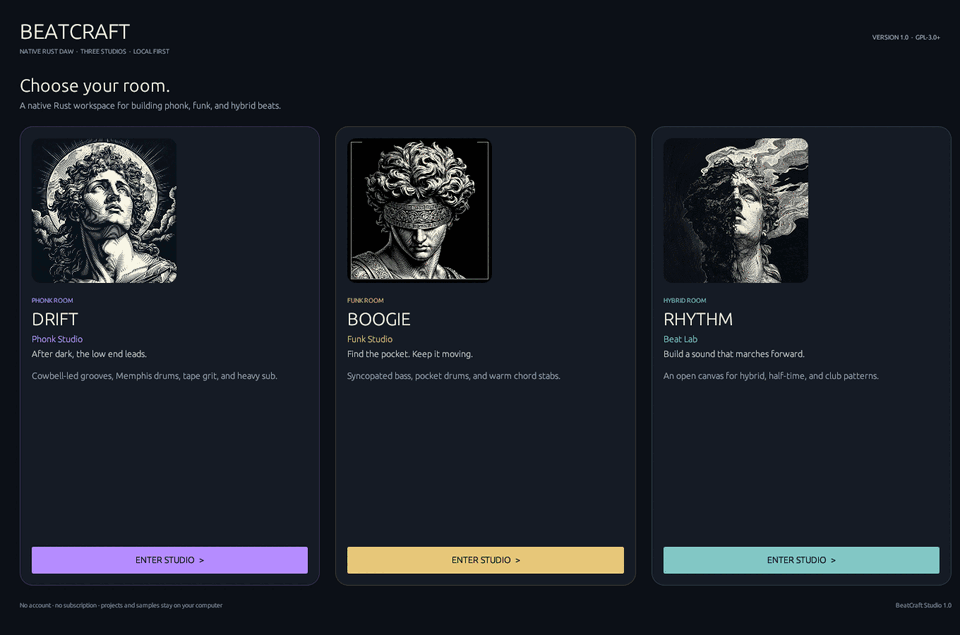
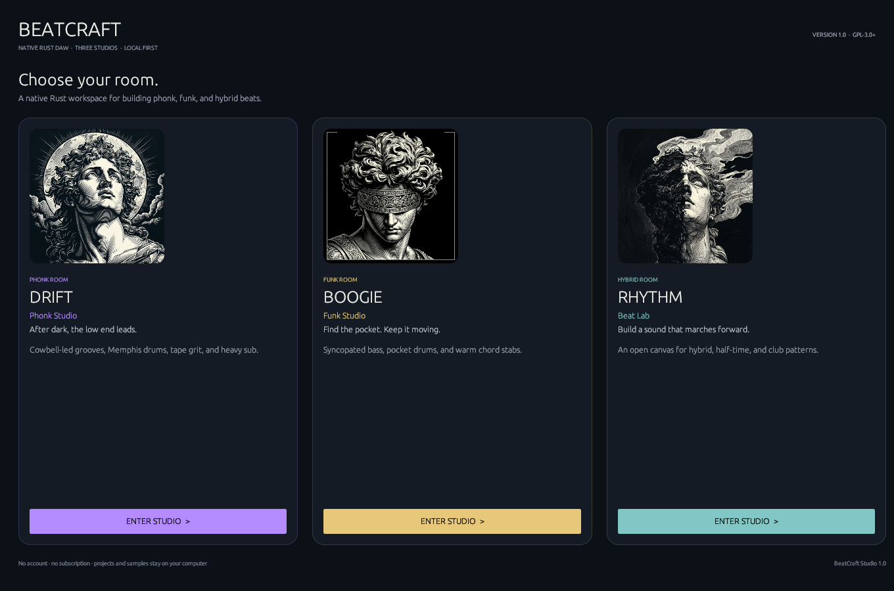
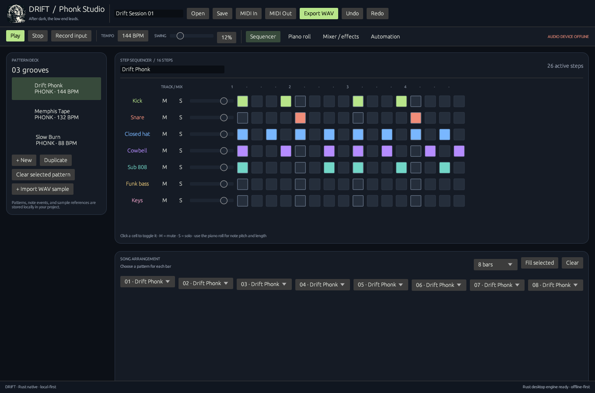
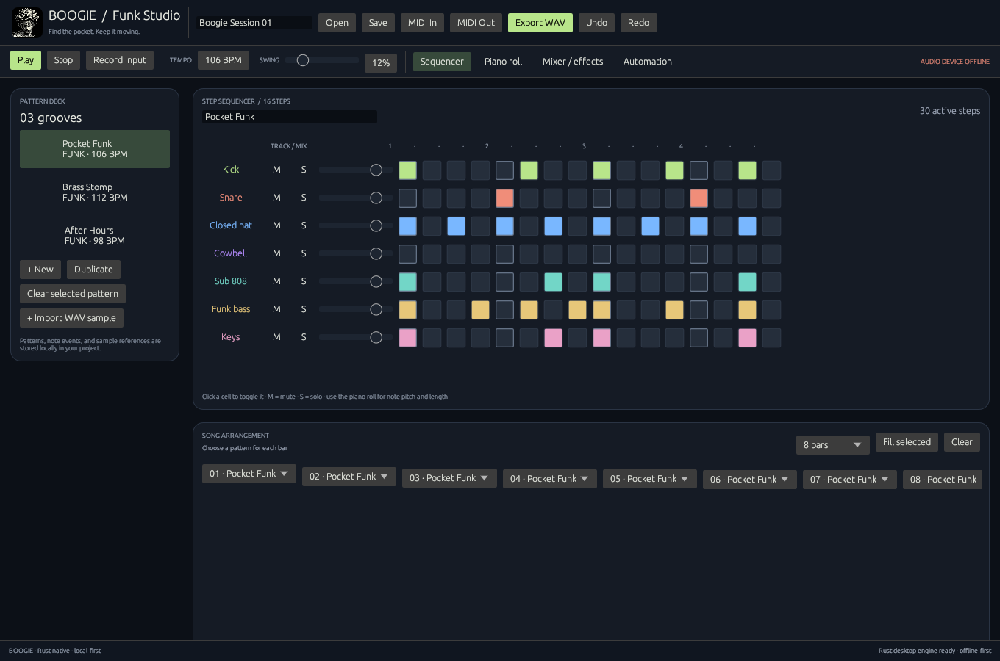
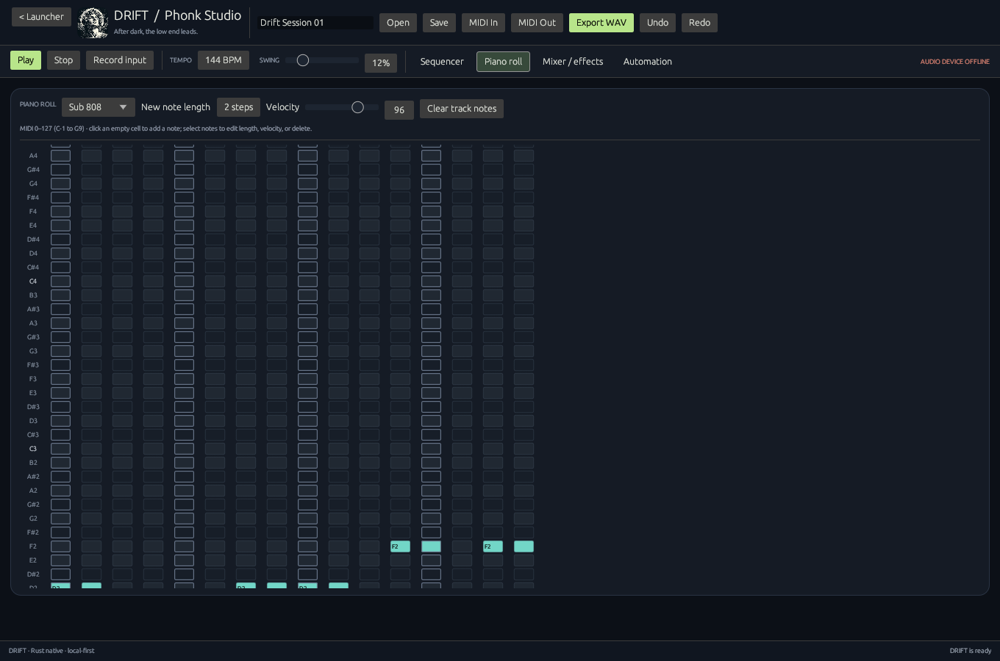

# BeatCraft Studio

[](https://github.com/esoexe/beatcraft-studio/actions/workflows/build-apps.yml)
[](LICENSE)

**BeatCraft Studio is a free, open-source, native desktop beatmaking DAW written in Rust.** It is not a browser or HTML app. The project includes a launcher and three studios that can also be opened directly:

- **BeatCraft Studio** — choose a workspace from the launcher.
- **DRIFT — Phonk Studio** — cowbell-led grooves, Memphis-style drums, tape grit, and sub.
- **BOOGIE — Funk Studio** — syncopated bass, pocket drums, and chord stabs.
- **RHYTHM — Beat Lab** — a flexible room for hybrid, half-time, and club patterns.



The launcher uses subtle animated accent borders. During playback, a moving sequencer playhead follows the audio position while the transport indicator pulses.

## Screenshots









## V1.2 features

- **Four floors, one launcher** — BeatForge (drums), Drift (gliding bass), Boogie
  (keys/leads), Rhythm (polyrhythm layers) — each a complete standalone studio.
- **Tracker + piano roll + automation lanes** — three native ways to write music,
  all editable with undo/redo everywhere.
- **Full mixer** — per-track volume, pan, mute/solo, transient shaper, drive,
  chorus/delay send FX.
- **Hardware MIDI-in** *(new in 1.2)* — connect any controller, arm MIDI REC, play along: notes quantize straight onto the grid, GM-mapped on drum floors, pitched on Drift/Boogie.
- **Streaming render pipeline** *(new in 1.2)* — bounces run on a background worker with live bar progress; UI stays live; playback rolls the moment audio lands.
- **MASTER SUITE mastering chain** *(new in 1.1)* — 3-band EQ, mid/side stereo
  width, feedforward compressor and tanh limiter on the final buss, right in the
  mixer — bounce loud, finished masters.
- **Pro export** *(new in 1.1)* — 16-bit, **24-bit**, or **32-bit float** WAV at
  44.1 or 48 kHz, selected right in the toolbar.
- **Autosave + crash recovery** *(new in 1.1)* — unsaved sessions are continuously
  backed up locally and offered for one-click recovery after an interruption.
- **MIDI out/in files** — export patterns to Standard MIDI Files, import your
  library; load your own audio samples.
- **Everything local-first** — zero accounts, zero telemetry, GPL-3.0 forever.

## Scope and current limitations

This is a usable V1 foundation—not a claim of parity with FL Studio, Ableton Live, Logic Pro, or another mature DAW. Playback renders the arrangement to memory before sending it to the default audio output; it is **not** a low-latency live instrument/mixing engine. Device selection, MIDI hardware input, plugin hosting (VST/AU/LV2), broad audio-format support, advanced clip editing, and crash recovery are not implemented. MIDI import supports metrical-timed files and maps their events into BeatCraft tracks; SMPTE-timed files are not supported. Automation is limited to volume and pan. Please treat audio-device support as hardware-dependent.

The app has been compiled, tested, and launch-smoke-tested on Linux (X11/Xvfb). Windows and macOS are build targets in the included CI workflow, but have not yet been manually verified on physical systems. Cross-platform support is the goal; report platform-specific issues with your OS and audio-device details.

## Build and run

Install **Rust 1.88 or newer** and Cargo. On Debian/Ubuntu, install the native build prerequisites first:

```bash
sudo apt install build-essential pkg-config libasound2-dev libxkbcommon-x11-0 libxcb-xkb1
```

Run the launcher or open a focused studio directly:

```bash
cargo run --bin beatcraft-studio
cargo run --bin beatcraft-drift
cargo run --bin beatcraft-boogie
cargo run --bin beatcraft-rhythm
```

Build optimized executables for the current operating system:

```bash
cargo build --release --locked --bins
```

The binaries are written to `target/release/` (`.exe` on Windows). Builds are native to the host OS; use a Windows runner for Windows builds and a macOS runner for macOS builds. This repository currently ships executables, not signed installers or app-store packages.

## Checks

```bash
cargo fmt --all -- --check
cargo check --all-targets --locked
cargo test --all-targets --locked
cargo clippy --all-targets --locked -- -D warnings
```

The tests cover the project model, synthesis/rendering, automation interpolation, looped sample handling, MIDI round-trips, and portable project/sample saving. Physical audio input/output behavior still needs testing on real devices.

## Projects, privacy, and license

Projects and sample assets stay on your computer unless you choose to copy or publish them. BeatCraft does not contact a hosted service. Project files are JSON; when saving, imported sample files are copied into a sibling `_assets` folder so the project is easier to move.

BeatCraft Studio is free/open-source software under **GNU GPL v3.0 or later**. See [`LICENSE`](LICENSE), [`THIRD_PARTY_NOTICES.md`](THIRD_PARTY_NOTICES.md), [`CONTRIBUTING.md`](CONTRIBUTING.md), and [`ROADMAP.md`](ROADMAP.md). Publishing guidance for `esoexe/beatcraft-studio` is in [`GITHUB_PUBLISHING.md`](GITHUB_PUBLISHING.md).
